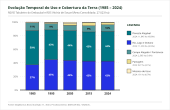
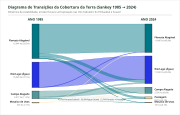

# Atlas Cartográfico e Análise Multitemporal: REVIS Tabuleiro do Embaubal e RDS Vitória de Souzel

[](https://qgis.org/)
[-orange.svg)](https://mapbiomas.org/)
[](https://earthengine.google.com/)
[](https://epsg.io/31982)
[](https://ideflorbio.pa.gov.br/)

---

## 1. Apresentação e Contexto Institucional

Este repositório documenta e consolida o acervo cartográfico, as rotinas de geoprocessamento em nuvem (**Google Earth Engine - GEE**), scripts de automação em **PyQGIS** e a análise multitemporal de uso e cobertura da terra (1985–2024) das seguintes Unidades de Conservação Estaduais do Pará:

* **Refúgio de Vida Silvestre (REVIS) Tabuleiro do Embaubal** (Decreto Estadual nº 1.566/2016 — 4.035,71 ha)
* **Reserva de Desenvolvimento Sustentável (RDS) Vitória de Souzel** (Decreto Estadual nº 1.567/2016 — 22.987,41 ha)
* **Área Total Mapeada:** **27.023,12 ha**
* **Localização:** Baixo Rio Xingu, municípios de Senador José Porfírio e Porto de Moz, Estado do Pará (Região de Integração do Xingu).

O projeto atende às demandas técnicas estabelecidas no Plano de Gestão das UCs pelo **Instituto de Desenvolvimento Florestal e da Biodiversidade do Estado do Pará (IDEFLOR-Bio)**, articulado pela **Diretoria de Gestão e Monitoramento de Unidades de Conservação (DGMUC)** e executado pelo **Núcleo de Geotecnologias (NGEO)**.

---

## 2. Dinâmica Multitemporal de Cobertura da Terra (1985 – 2024)

Com base na **Coleção 11 do MapBiomas Brasil** (resolução espacial de 30 metros), foram avaliados 40 anos de dinâmica territorial em 5 marcos temporais decenais (**1985, 1995, 2005, 2015 e 2024**). O processamento zonal foi executado diretamente no Google Earth Engine através de redução elipsoidal de área por pixel.

### Evolução das Classes de Cobertura na Área Consolidada (27.023,12 ha)

<p align="center">
  
</p>

### Balanço Quantitativo Decenal Consolidado

| ID | Classe Oficial (Coleção 11) | 1985 (ha) | 1985 (%) | 1995 (ha) | 1995 (%) | 2005 (ha) | 2005 (%) | 2015 (ha) | 2015 (%) | 2024 (ha) | 2024 (%) |
|:--:|:----------------------------|----------:|---------:|----------:|---------:|----------:|---------:|----------:|---------:|----------:|---------:|
| **6** | **Floresta Alagável** | 13.643,8 | 50,5% | 11.725,1 | 43,4% | 11.824,9 | 43,8% | 11.565,5 | 42,8% | 11.845,4 | **43,8%** |
| **33** | **Rio, Lago e Oceano** | 10.039,2 | 37,2% | 12.157,1 | 45,0% | 11.826,4 | 43,8% | 11.502,2 | 42,6% | 11.500,3 | **42,6%** |
| **11** | **Campo Alagado / Pantanoso** | 3.016,9 | 11,2% | 2.530,6 | 9,4% | 2.087,0 | 7,7% | 2.499,9 | 9,2% | 2.595,4 | **9,6%** |
| **15** | **Pastagem** | 0,0 | 0,0% | 300,3 | 1,1% | 588,4 | 2,2% | 1.192,7 | 4,4% | 826,9 | **3,1%** |
| **21** | **Mosaico de Usos** | 301,9 | 1,1% | 254,5 | 0,9% | 631,9 | 2,3% | 198,2 | 0,7% | 181,2 | **0,7%** |
| **12** | **Formação Campestre** | 0,0 | 0,0% | 37,1 | 0,1% | 46,3 | 0,2% | 46,3 | 0,2% | 43,8 | **0,2%** |
| **3** | **Formação Florestal** | 18,4 | 0,1% | 18,5 | 0,1% | 18,4 | 0,1% | 18,4 | 0,1% | 24,2 | **0,1%** |
| **-** | **Total Geral** | **27.023,1** | **100%** | **27.023,1** | **100%** | **27.023,1** | **100%** | **27.023,1** | **100%** | **27.023,1** | **100%** |

---

## 3. Diagrama de Transições da Cobertura da Terra (Sankey 1985 → 2024)

O cruzamento espacial pixel a pixel (302.642 pixels avaliados) entre o marco inicial de 1985 e o marco recente de 2024 permitiu mapear os fluxos físicos de estabilidade, dinâmica fluvial e antropização:

<p align="center">
  
</p>

### Principais Constatações Ecológicas
1. **Alta Estabilidade dos Ecossistemas Alagáveis:** 
   * **11.643,6 ha (43,09%)** de Floresta Alagável permaneceram estritamente intactos entre 1985 e 2024.
   * **9.899,2 ha (36,63%)** correspondem à calha estável do Rio Xingu e corpos d'água perenes.
2. **Dinâmica Fluvial Hidrossedimentar (Erosão e Sedimentação Insular):**
   * **1.127,7 ha (4,17%)** de floresta alagável foram engolidos por cheias e migração dos canais fluviais (furos e praias).
   * **129,9 ha (0,48%)** de áreas antes mapeadas como água formaram novas ilhas e restingas por assoreamento e colonização vegetal.
3. **Trajetória da Antropização:**
   * A classe **Pastagem** surge no registro histórico a partir de 1995 (300 ha), atinge seu ápice histórico em 2015 (1.192,7 ha, 4,4%) e demonstra **desaceleração e recuo em 2024** (826,9 ha, 3,1%), concentrando-se quase exclusivamente no setor sul da RDS Vitória de Souzel. O REVIS manteve-se livre de impactos expressivos (pastagem ocupa apenas 9,1 ha ou 0,22% da unidade).

---

## 4. Produtos Cartográficos Disponíveis (Série A1)

Os mapas temáticos impressos foram estruturados na escala de detalhe em formato A1 com grid UTM 22S, legenda categorizada, mapa de localização estadual e painéis infográficos customizados:

| Produto | Tema Cartográfico | Descrição / Destaques |
|:--:|:---|:---|
| **01** | **Limites Territoriais e UCs** | Demarcação legal das poligonais estaduais (REVIS e RDS) e municípios limítrofes. |
| **02** | **Gestão e Infraestrutura** | Base do IDEFLOR-Bio, comunidades tradicionais, trapiches e trajetos fluviais de fiscalização. |
| **03** | **Biodiversidade e Proteção** | Áreas de desova de quelônios (*Podocnemis expansa*), praias de reprodução e berçários aquáticos. |
| **04** | **Comunidades e Uso Tradicional** | Mapeamento das 282 moradias ribeirinhas, ranchos e apoios de pesca artesanal. |
| **05** | **Quadro Hidrográfico** | Inventário detalhado de furos, igarapés, enseadas, baías e praias fluviais no Rio Xingu. |
| **06** | **Análise Temporal (1985–2024)** | Cinco pranchas individuais (uma por ano: 1985, 1995, 2005, 2015, 2024) com infográfico exclusivo. |

---

## 5. Estrutura de Diretórios do Repositório

```text
├── tabuleiro_do_embaubal_e_vitoria_souzel.qgz   # Projeto principal configurado no QGIS 4.x
├── layout.qpt                                   # Template padrão de impressão A1
├── camadas/                                     # Dados vetoriais e matriciais organizados
│   ├── 00_ucs_alvo_embaubal_souzel.geojson     # Polígonos oficiais do REVIS e da RDS
│   ├── 00_ucs_estaduais_todas.geojson          # 29 Unidades de Conservação do Pará
│   ├── 01_moradores_e_comunidades.geojson      # Pontos das comunidades ribeirinhas
│   ├── 02_apoio_de_pesca_e_ranchos.geojson     # Infraestruturas pesqueiras
│   ├── 03_areas_de_desova.geojson              # Tabuleiros e praias de desova
│   ├── 04_hidrografia.geojson                  # Furos, igarapés e rios do levantamento
│   ├── 05_ilhas_e_praias.geojson               # Bancos de areia e ilhas fluviais
│   ├── 06_infraestrutura_e_equipamentos.geojson# Equipamentos públicos e bases operacionais
│   ├── 07_marcos_e_pontos_referencia.geojson   # Marcos geodésicos e referências locais
│   ├── 08_vegetacao_e_flora.geojson            # Árvores matrizes e berçários
│   ├── 09_ocorrencias_e_impactos.geojson       # Evidências de queimadas e impactos
│   ├── 10_trajetos_e_acessos.geojson           # Rotas fluviais de navegação
│   ├── raster/                                 # GeoTIFFs MapBiomas Coleção 11 recortados
│   │   ├── mapbiomas_c11_2024_buffer5km.tif    # Cobertura 2024 com buffer de contexto (5 km)
│   │   ├── mapbiomas_c11_2024_limites_exatos_ucs.tif # Cobertura 2024 restrita às UCs
│   │   └── mapbiomas_c11_temporal_1985_2024.tif # Stack multibandas (1985, 1995, 2005, 2015, 2024)
│   └── tabelas/                                # Estatísticas e matrizes de transição
│       ├── estatisticas_mapbiomas_c11_revis_rds.csv # Planilha oficial extraída via GEE
│       └── transicoes_mapbiomas_1985_2024.json # Matriz de transição para o Sankey
├── paineis_tematicos_svg/                       # Infográficos técnicos para o layout A1
│   ├── painel_mapa_ano_1985.svg                # Painel de cobertura do solo (1985)
│   ├── painel_mapa_ano_1995.svg                # Painel de cobertura do solo (1995)
│   ├── painel_mapa_ano_2005.svg                # Painel de cobertura do solo (2005)
│   ├── painel_mapa_ano_2015.svg                # Painel de cobertura do solo (2015)
│   ├── painel_mapa_ano_2024.svg                # Painel de cobertura do solo (2024)
│   ├── relatorio_grafico_serie_historica.svg   # Figura acadêmica da série histórica
│   └── relatorio_diagrama_sankey.svg           # Figura acadêmica do fluxo de transições
├── scripts/                                    # Automações portáveis em Python e GEE
│   ├── gee_export_mapbiomas_c11.js             # Rotina GEE Code Editor para download dos rasters
│   ├── gee_calcular_estatisticas_ucs.js        # Rotina GEE para redução zonal e exportação CSV
│   ├── aplicar_estilo_mapbiomas_c11.py         # Script PyQGIS para classificação e simbologia
│   └── gerar_todos_produtos_mapbiomas.py       # Gerador dos diagramas SVG analíticos
└── simbologia/                                 # Bibliotecas visuais e arquivos de estilo
    ├── mapbiomas_colecao11.qml                 # Estilo QGIS raster oficial da Coleção 11
    └── mapbiomas_c11_legenda.json              # Dicionário JSON de classes e códigos hex
```

---

## 6. Como Reproduzir e Executar o Projeto

### A. Abrir o Projeto no QGIS
1. Certifique-se de ter o **QGIS 3.28 LTR** ou **QGIS 3.34+ / 4.x** instalado.
2. Abra o arquivo [`tabuleiro_do_embaubal_e_vitoria_souzel.qgz`](tabuleiro_do_embaubal_e_vitoria_souzel.qgz).
3. O projeto carregará automaticamente as camadas vetoriais estilizadas, mapas base de satélite e limites legais.

### B. Estilização Automática do MapBiomas via PyQGIS
O script [`scripts/aplicar_estilo_mapbiomas_c11.py`](scripts/aplicar_estilo_mapbiomas_c11.py) é 100% portável e dispensa caminhos absolutos:
1. Abra o **Console Python** no QGIS (`Ctrl + Alt + P`).
2. Abra e execute o script [`scripts/aplicar_estilo_mapbiomas_c11.py`](scripts/aplicar_estilo_mapbiomas_c11.py).
3. O script varrerá os rasters carregados, aplicará as cores oficiais da Coleção 11 e gerará automaticamente o grupo desdobrado **"Série Temporal"** com as camadas individuais para cada ano prontas para alternância.

### C. Geração dos Gráficos e Painéis SVG
Para regenerar os gráficos de layout ou as figuras acadêmicas a partir de novos dados:
```bash
python scripts/gerar_todos_produtos_mapbiomas.py
```

---

## 7. Responsabilidade Técnica e Expediente

* **Governo do Estado do Pará**
* **Secretaria de Estado de Meio Ambiente e Sustentabilidade (SEMAS/PA)**
* **Instituto de Desenvolvimento Florestal e da Biodiversidade do Pará (IDEFLOR-Bio)**
* **Diretoria de Gestão e Monitoramento de Unidades de Conservação (DGMUC)**
* **Núcleo de Geotecnologias (NGEO)**
  * **Responsável Técnico / Execução:** Samuel C. Santos (`samuelsantosambiental@gmail.com`)
  * **Sistema Geodésico:** SIRGAS 2000 / UTM Zona 22 Sul (EPSG: 31982)
  * **Data de Publicação:** Outubro / 2026
